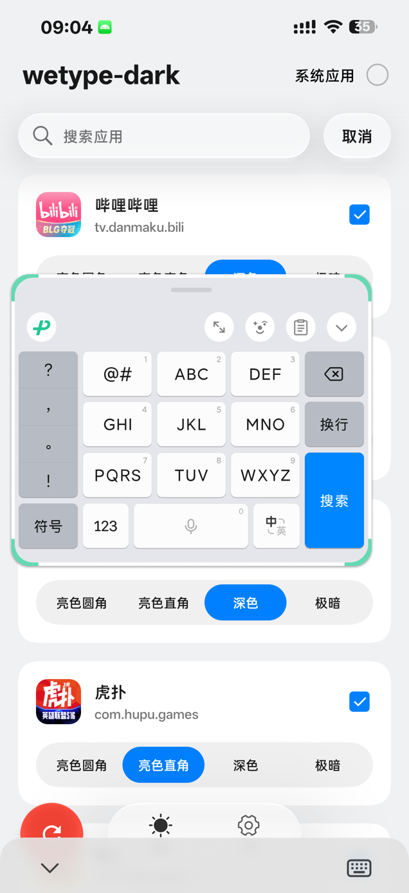
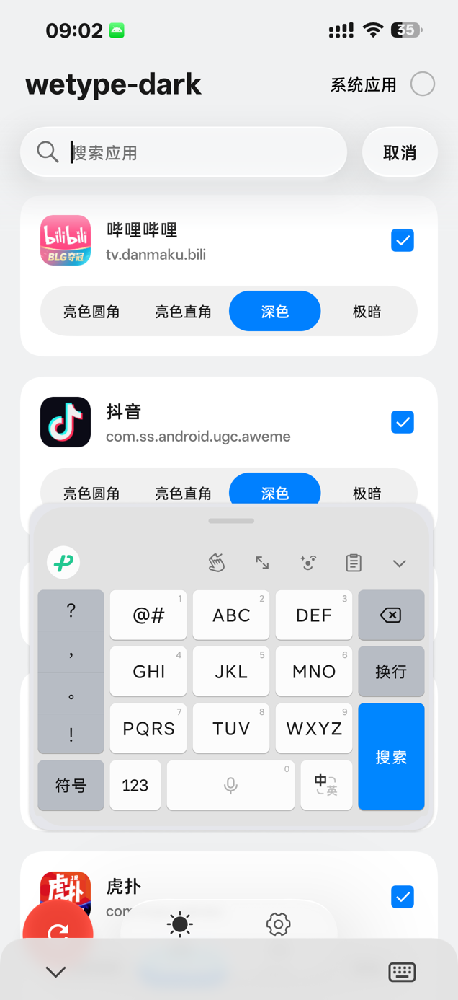
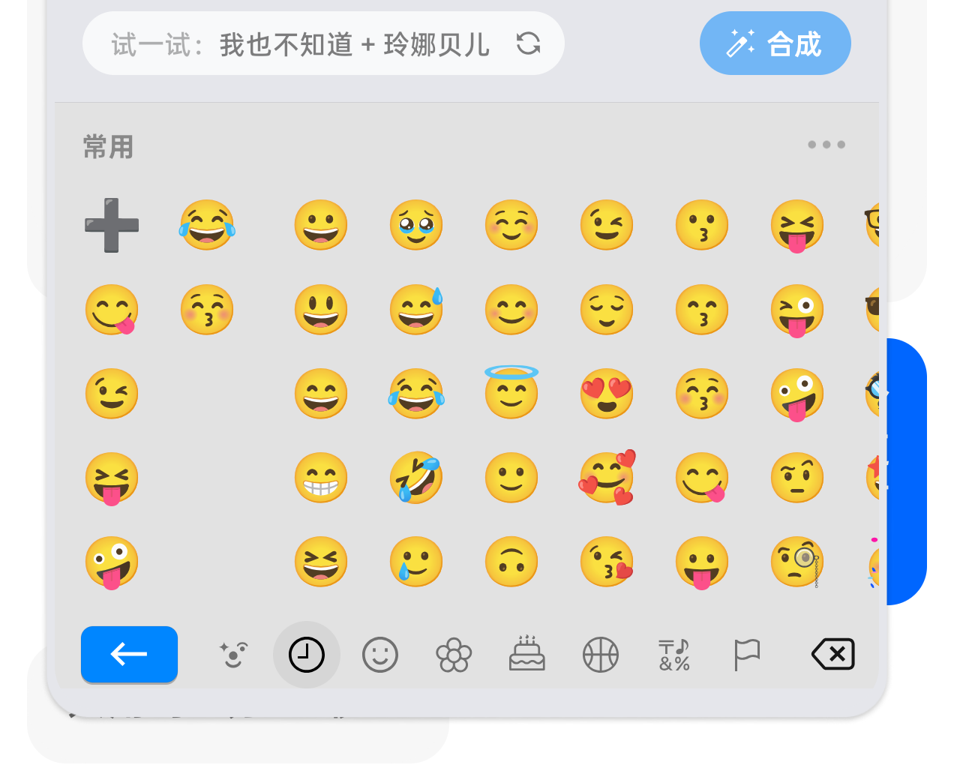

# wetype-dark

微信输入法（WeType）的 LSPosed 模块，给键盘换成自己的配色：亮色 / 深色 / 极暗三套皮肤、面板磨砂、按键自绘、候选词与功能键统一取色，并附带一个实时调色台。

> 本仓库**只发布二进制**，源码不公开。

## 效果预览

| 悬浮键盘 | 横屏悬浮 | 表情页 |
| --- | --- | --- |
|  |  |  |

## 功能

- **三套皮肤**：亮色圆角 / 亮色直角 / 深色 / 极暗，支持按应用单独指定（逐应用模式）。
- **面板磨砂**：ColorOS / 澎湃 OS 原生背景模糊，面板自身一层半透明色层，圆角与模糊同源。
- **按键自绘**：键面渐变色、描边、投影、键帽圆角都可调，字母 / 数字 / 符号 / 表情 / 手写各页统一。
- **候选栏 / 功能键**：候选条底色、候选词文字色、右侧 AI 表情 / 剪贴板 / 收起三颗功能键配色统一。
- **悬浮键盘**：拖动面板不糊屏，表情页有独立底色，横屏悬浮底部不再出现满宽长条。
- **实时调色台**：内置网页调色台，改完即时下发到键盘，不用重启输入法。

## 安装

1. 设备需要 Magisk / KernelSU + **LSPosed**（Android 9 以上）。
2. 安装 `wetype-dark-v1.x.apk`。
3. 在 LSPosed 里启用本模块，作用域勾选 **微信输入法**（`com.tencent.wetype`）。
4. 重启微信输入法进程（或重启手机），重新唤起键盘即可。

> 首次使用建议先备份微信输入法自己的皮肤设置，本模块只改绘制层，不改宿主配置。

## 兼容性

- 微信输入法：4.0.1（其他版本未逐一验证，宿主类名混淆后可能失效）
- 系统：ColorOS 16（Android 16）实测；小米澎湃 OS 3 有对应模糊实现；AOSP 系走普通色层
- 分辨率：任意，圆角/模糊按 dp 换算

## 已知限制

- 只对**自绘键盘**生效，宿主自带的第三方皮肤资源不会被改写。
- 横屏悬浮与分体键盘的宿主行为不稳定，个别机型切换后偶发面板底色丢失，重新唤起一次可恢复。
- 不修改微信输入法数据，不联网上报，无遥测。

## 更新日志

### v1.0
- 亮色 / 深色 / 极暗三套皮肤与逐应用模式
- 面板磨砂、按键自绘、候选栏配色
- 悬浮键盘：拖动不糊屏、表情页补底、横屏悬浮去底部长条

## 许可

见 [LICENSE](LICENSE)：仅授权个人非商业使用，禁止二次分发与反编译再发布。
